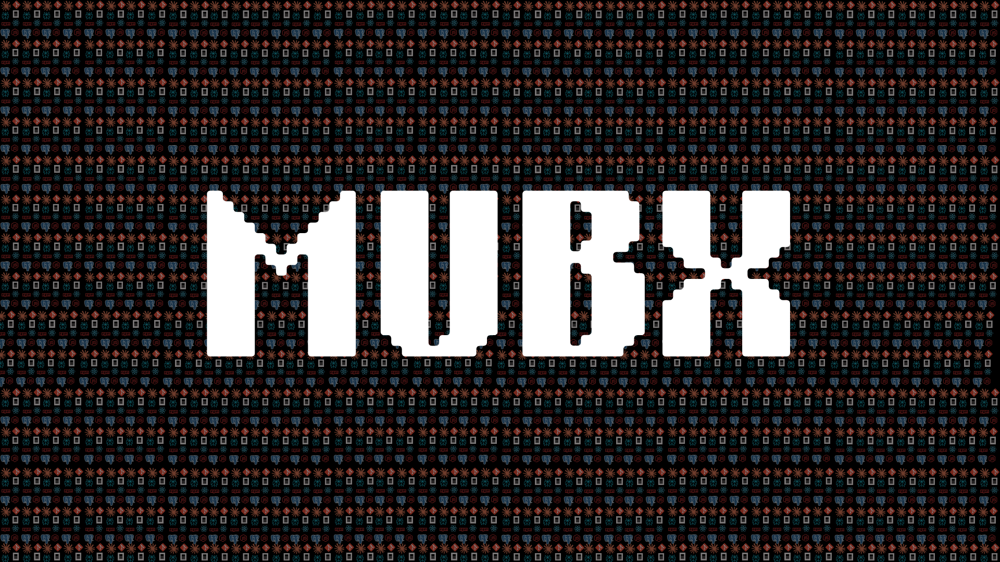

# Omar Mubaidin | Full-Stack Developer · Amman, Jordan 🇯🇴

*I build fast, secure, and scalable digital products with strong UI, real-world usefulness, and clean engineering.*

 

  

 

  

 

  

---

## 🚀 Featured Projects

| Project | What it is | Stack |
|---------|------------|-------|
| [**HTUAI**](https://github.com/Omarmubx7/htuai) | AI-powered course tracker for HTU students | TypeScript, Next.js |
| [**mubxbot**](https://github.com/Omarmubx7/mubxbot) | Automation and bot-based experimentation project | JavaScript |
| [**java-projects**](https://github.com/Omarmubx7/java-projects) | Practice and implementation of data structures and algorithms | Java |
| [**htu_martial_arts-man**](https://github.com/Omarmubx7/htu_martial_arts-man) | Martial arts management project for HTU | PHP |

---

## 📊 GitHub Stats

 

---

## 📫 Contact

The fastest way to reach me is through [LinkedIn](https://linkedin.com/in/omarmubaidin), [Instagram](https://instagram.com/mubx.dev), or [email](mailto:omarmubaidin@proton.me).

You can also find my links and work hub at [mubx.dev/links](https://mubx.dev/links).

---

*Ship it, then iterate.*

